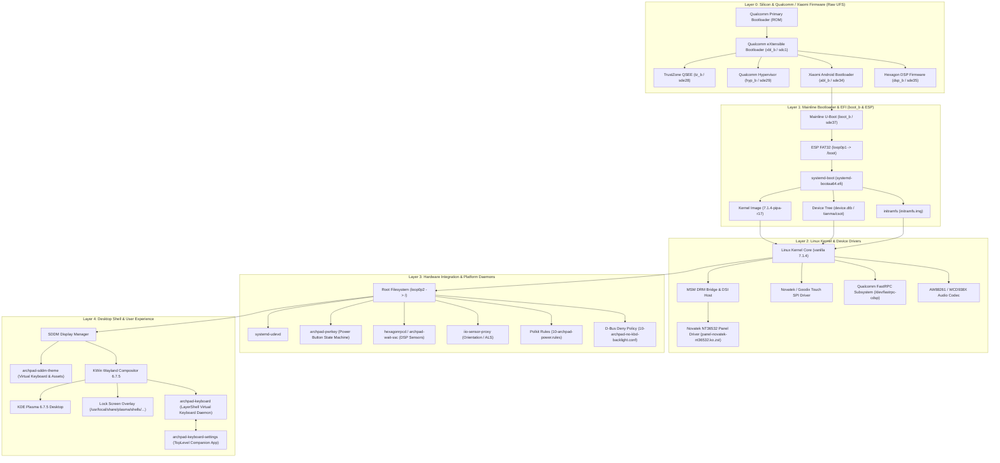

# ArchPad System Architecture & Component Inventory
**Hardware Platform:** Xiaomi Pad 6 (`pipa` / Qualcomm Snapdragon 870 SM8250)  
**Operating System:** Arch Linux ARM (Kernel: `7.1.4-pipa-r17`, Compositor: KWin Wayland 6.7.5, Desktop: KDE Plasma 6.7.5, Qt: 6.11.2)  
**Document Revision:** 1.0 (September 2026)  
**Status:** Canonical Reference

---

## 1. Architectural Philosophy & Storage Model

### 1.1 Physical vs. Logical Storage Separation
On Qualcomm Snapdragon SM8250 hardware, storage is not a single PC-style Master Boot Record or GUID partition table. The onboard Universal Flash Storage (UFS 3.1) controller exposes **six independent hardware SCSI Logical Unit Numbers (LUNs)**:

* **Hardware LUNs 1–5 (`sdb` to `sdf`):** Contain raw, cryptographically signed Qualcomm and Xiaomi firmware (PBL, XBL, TrustZone, Hypervisor, DSP, Keymaster) and cellular/radio NVRAM partitions. These exist **completely outside** the Linux filesystem.
* **Hardware LUN 0 (`sda`):** Contains vendor metadata, partition tables, and the 106.6 GB `userdata` partition (`sda34`).
* **The Nested GPT Disk (`loop0`):** Arch Linux ARM does not run directly on raw UFS partitions. Instead, `userdata` (`sda34`) hosts a standard GPT partition table formatted with a 4096-byte logical sector size:
  * **Partition 1 (`loop0p1`, 480 MB):** EFI System Partition (FAT32, mounted at `/boot`).
  * **Partition 2 (`loop0p2`, 106.1 GB):** Root Filesystem (ext4, mounted at `/`).

```
┌───────────────────────────────────────────────────────────────────────────────────┐
│                           Physical UFS 3.1 Controller                             │
├──────────────┬──────────────┬──────────────┬──────────────┬───────────────────────┤
│ LUN 1 (sdb)  │ LUN 2 (sdc)  │ LUN 3 (sdd)  │ LUN 5 (sdf)  │      LUN 4 (sde)      │
│  xbl_a (8MB) │  xbl_b (8MB) │  DDR Config  │  Modem NVRAM │  tz, hyp, dsp, abl    │
│  xbl_config  │  xbl_config  │  CDT / MDD   │  fsc, fsg    │  boot_a, boot_b (192M)│
└──────────────┴──────────────┴──────────────┴──────────────┴───────────┬───────────┘
                                                                        │
┌───────────────────────────────────────────────────────────────────────┴───────────┐
│                                    LUN 0 (sda)                                    │
│  persist (sda22), cust (sda28), super (sda29), userdata (sda34, 106.6 GB)         │
└────────────────────────────────────────┬──────────────────────────────────────────┘
                                         │ losetup -Pf --sector-size 4096
                                         ▼
┌───────────────────────────────────────────────────────────────────────────────────┐
│                             Nested GPT on userdata (loop0)                        │
├────────────────────────────────────────┬──────────────────────────────────────────┤
│ Partition 1: loop0p1 (FAT32, 480 MB)   │ Partition 2: loop0p2 (ext4, 106.1 GB)    │
│ Mount: /boot (EFI System Partition)    │ Mount: / (Arch Linux ARM Rootfs)         │
│ - systemd-boot EFI binary              │ - Upstream Arch Linux system tree        │
│ - Kernel Image, DTB, initramfs         │ - /usr/lib/modules/<kernel-release>/     │
│ - systemd-boot loader configuration    │ - Wayland Compositor, Plasma Shell, Apps │
└────────────────────────────────────────┴──────────────────────────────────────────┘
```

---

## 2. Master System Dataflow & Boot Topology



---

## 3. Component Classification Legend

Every file in the system is tagged with its origin and maintenance policy:

| Tag | Category | Maintenance Policy |
| :---: | :--- | :--- |
| 🟣 | **`[OEM-BLOB]`** | Untouched, factory-signed binary from Xiaomi/Qualcomm. Never altered. |
| 🔵 | **`[UPSTREAM-DISTRO]`** | Unmodified official package binary from Arch Linux ARM (`alarm`) repositories. |
| 🟢 | **`[UPSTREAM-KERNEL]`** | Vanilla Linux kernel source tree (Linus / stable branch). |
| 🟡 | **`[MAINLINE-COMMUNITY]`**| Out-of-tree patch tracked by `pipa-mainline` or submitted upstream to LKML. |
| 🔴 | **`[ARCHPAD-CUSTOM]`** | Custom driver, daemon, application, or policy created specifically for ArchPad. |
| 🟠 | **`[DISTRO-EXCEPTION]`** | Standard upstream package overridden via XDG precedence (`/usr/local/share`). |

---

## 4. Physical UFS Partition Map (Snapdragon 870 / pipa)

| LUN | Block Device | Partition Name | Size | File System | Tag | Purpose |
| :--- | :--- | :--- | :--- | :--- | :---: | :--- |
| **0** | `/dev/sda20` | `splash` | 32 MB | Raw | 🟣 | Boot splash screen container (zeroed on pipa; rendered by ABL) |
| **0** | `/dev/sda16` | `devinfo` | 16 MB | Raw | 🟣 | Qualcomm device info & bootloader unlock flag (`is_unlocked=1`) |
| **0** | `/dev/sda11` | `misc` | 4 MB | Raw | 🟣 | Bootloader Control Block (BCB) for recovery commands |
| **0** | `/dev/sda22` | `persist` | 64 MB | ext4 | 🟣 | Sensor & Wi-Fi MAC calibration data |
| **0** | `/dev/sda34` | `userdata` | 106.6 GB| GPT Table | 🔴 | Container partition holding nested GPT disk `loop0` |
| **1** | `/dev/sdb1` | `xbl_a` | 8 MB | Raw | 🟣 | Qualcomm eXtensible Bootloader Slot A |
| **1** | `/dev/sdb2` | `xbl_config_a` | 8 MB | Raw | 🟣 | Primary bootloader hardware configuration Slot A |
| **2** | `/dev/sdc1` | `xbl_b` | 8 MB | Raw | 🟣 | Qualcomm eXtensible Bootloader Slot B |
| **2** | `/dev/sdc2` | `xbl_config_b` | 8 MB | Raw | 🟣 | Primary bootloader hardware configuration Slot B |
| **4** | `/dev/sde3/28`| `tz_a` / `tz_b` | 4 MB | Raw | 🟣 | Qualcomm TrustZone OS (QSEE secure world) |
| **4** | `/dev/sde4/29`| `hyp_a` / `hyp_b` | 8 MB | Raw | 🟣 | Qualcomm Type-1 Hardware Hypervisor |
| **4** | `/dev/sde9/34`| `abl_a` / `abl_b` | 2 MB | Raw | 🟣 | Xiaomi Android Bootloader (authenticates and jumps to boot) |
| **4** | `/dev/sde10/35`| `dsp_a` / `dsp_b` | 64 MB | Raw | 🟣 | Hexagon DSP firmware image (CDSP, ADSP, SLPI) |
| **4** | `/dev/sde11/36`| `keymaster_a/b` | 1 MB | Raw | 🟣 | Hardware keystore and cryptographic attestation |
| **4** | `/dev/sde12` | `boot_a` | 192 MB | Android Boot| 🔴 | Mainline U-Boot payload Slot A (backup boot slot) |
| **4** | `/dev/sde37` | `boot_b` | 192 MB | Android Boot| 🔴 | Mainline U-Boot payload Slot B (active primary boot slot) |
| **5** | `/dev/sdf2/3` | `modemst1/st2` | 2 MB | Raw | 🟣 | Cellular/RF calibration state (zeroed on Wi-Fi-only pipa) |
| **5** | `/dev/sdf4/5` | `fsg` / `fsc` | 2 MB / 128K| Raw | 🟣 | Golden NVRAM calibration (zeroed on Wi-Fi-only pipa) |

---

## 5. Layered Binary & File Inventory

### Layer 1: Bootloader & EFI Runtime

All files in this layer reside on the active boot partition or the FAT32 EFI System Partition (`/boot`):

```
/dev/sde37 (UFS LUN 4 / boot_b)
└── [Raw Partition Start]
    └── u-boot-xiaomi-pipa.img          [🔴 ARCHPAD-CUSTOM] Mainline U-Boot 2024 (SHA256: 76080a59...)

/boot/ (ESP - loop0p1 FAT32)
├── EFI/
│   ├── BOOT/
│   │   └── BOOTAA64.EFI                [🔵 UPSTREAM-DISTRO] Freedesktop systemd-boot UEFI binary
│   └── systemd/
│       └── systemd-bootaa64.efi        [🔵 UPSTREAM-DISTRO] Freedesktop systemd-boot loader
├── loader/
│   ├── loader.conf                     [🔴 ARCHPAD-CUSTOM] Boot default & timeout configuration
│   └── entries/
│       └── archpad-7.1.4-pipa-r17.conf [🔴 ARCHPAD-CUSTOM] Boot entry specification for r17
└── archpad/
    └── 7.1.4-pipa-r17/
        ├── Image                       [🟢/🟡 KERNEL] Uncompressed AArch64 Linux Kernel (7.1.4)
        ├── device.dtb                  [🟡 MAINLINE-COMMUNITY] Flattened Device Tree Blob (CSOT/Tianma)
        ├── initramfs.img               [🔵 UPSTREAM-DISTRO] mkinitcpio early userspace ramdisk
        └── SHA256SUMS                  [🔴 ARCHPAD-CUSTOM] Cryptographic checksums for ESP integrity
```

---

### Layer 2: Linux Kernel & Device Drivers (`linux-archpad-pipa`)

The kernel tree is based on vanilla Linux `7.1.4` with 28 targeted patches:

#### Device Tree Blobs (`/boot/dtbs/qcom/`)
* `sm8250-xiaomi-pipa-tianma.dtb` **`[🟡 MAINLINE-COMMUNITY]`**: Device tree for Tianma panel hardware variant.
* `sm8250-xiaomi-pipa-csot.dtb` **`[🟡 MAINLINE-COMMUNITY]`**: Device tree for CSOT panel hardware variant.

#### Kernel Drivers & Loadable Modules (`/usr/lib/modules/7.1.4-pipa-r17/`)
```
/usr/lib/modules/7.1.4-pipa-r17/kernel/
├── drivers/
│   ├── gpu/drm/
│   │   ├── msm/
│   │   │   └── msm.ko.zst                     [🟢 UPSTREAM-KERNEL] Qualcomm Adreno/MSM DRM driver
│   │   └── panel/
│   │       └── panel-novatek-nt36532.ko.zst   [🟡 MAINLINE-COMMUNITY] Novatek NT36532 dual-DSI panel driver (Patch 0006)
│   ├── input/
│   │   ├── touchscreen/
│   │   │   └── nt36523_ts.ko.zst              [🟡 MAINLINE-COMMUNITY] Novatek NT36523 SPI touchscreen driver (Patch 0003)
│   │   └── keyboard/
│   │       └── nanosic_803.ko.zst             [🟡 MAINLINE-COMMUNITY] Xiaomi Folio accessory keyboard driver (Patch 0013)
│   ├── power/supply/
│   │   ├── pm8150b_charger.ko.zst             [🟡 MAINLINE-COMMUNITY] Qualcomm PMIC fuel gauge & charger (Patch 0002)
│   │   └── nuvolta_rx1665.ko.zst              [🟡 MAINLINE-COMMUNITY] Wireless charging receiver driver (Patch 0016)
│   ├── media/i2c/
│   │   ├── ov13b10.ko.zst                     [🟡 MAINLINE-COMMUNITY] OmniVision 13MP rear camera driver (Patch 0007)
│   │   ├── hi846.ko.zst                       [🟡 MAINLINE-COMMUNITY] Hynix 8MP front camera driver (Patches 0017-0025)
│   │   └── dw9768.ko.zst                      [🟡 MAINLINE-COMMUNITY] Voice-coil motor focus driver (Patch 0029)
│   └── remoteproc/
│       └── qcom_q6v5_pas.ko.zst               [🟢/🟡 KERNEL] Qualcomm Hexagon DSP peripheral auth (Patch 0030)
└── sound/soc/
    ├── codecs/
    │   └── snd-soc-aw88261.ko.zst             [🟡 MAINLINE-COMMUNITY] Awinic AW88261 quad-speaker amp driver (Patch 0010)
    └── qcom/
        └── qdsp6/
            └── snd-soc-q6afe.ko.zst           [🟡 MAINLINE-COMMUNITY] Hexagon Audio Frontend driver (Patches 0011-0012)
```

---

### Layer 3: Hardware Integration & Platform Services (`archpad-pipa-device`)

This layer provides device-specific glue code, power management, and hardware policies:

```
/usr/bin/
├── archpad-pwrkey              [🔴 ARCHPAD-CUSTOM] C daemon monitoring /dev/input/event* for power button edge logic
├── archpad-powerctl            [🔴 ARCHPAD-CUSTOM] Shell controller for power profiles and charging thresholds
├── archpad-powerd              [🔴 ARCHPAD-CUSTOM] Background power management daemon
├── archpad-usb-gadget          [🔴 ARCHPAD-CUSTOM] Configfs script initializing USB RNDIS/Ethernet (172.16.42.1)
├── archpad-wait-ssc            [🔴 ARCHPAD-CUSTOM] Synchronization script waiting for Hexagon Sensor DSP boot
├── archpad-wait-sensor-proxy   [🔴 ARCHPAD-CUSTOM] D-Bus listener awaiting net.hadess.SensorProxy registration
├── archpad-audio-reprobe       [🔴 ARCHPAD-CUSTOM] ALSA state reset tool for Qualcomm WCD/AW88261 audio paths
└── hexagonrpcd                 [🔵 UPSTREAM-DISTRO] Qualcomm FastRPC RPC daemon connecting userspace to Hexagon DSP

/usr/lib/systemd/system/
├── archpad-pwrkey.service           [🔴 ARCHPAD-CUSTOM] Systemd unit managing archpad-pwrkey daemon
├── archpad-powerd.service           [🔴 ARCHPAD-CUSTOM] Systemd unit managing archpad-powerd
├── archpad-usb-gadget.service       [🔴 ARCHPAD-CUSTOM] Systemd unit initializing USB gadget networking
├── archpad-hexagonrpcd-sdsp.service [🔴 ARCHPAD-CUSTOM] Systemd unit starting FastRPC daemon for sensors
└── archpad-audio-reprobe.service    [🔴 ARCHPAD-CUSTOM] Systemd unit reprobing audio after resume

/etc/dbus-1/system.d/
├── 10-archpad-no-kbd-backlight.conf [🔴 ARCHPAD-CUSTOM] D-Bus policy denying UPower KbdBacklight (kills ghost slider)
└── net.hadess.PowerProfiles.conf    [🔴 ARCHPAD-CUSTOM] D-Bus permissions for Power Profiles daemon

/usr/share/polkit-1/rules.d/
└── 10-archpad-power.rules           [🔴 ARCHPAD-CUSTOM] Polkit rule granting SDDM user sensor claim rights

/etc/udev/rules.d/
├── 10-archpad-power.rules           [🔴 ARCHPAD-CUSTOM] Power key input device labeling & wake permissions
├── 60-archpad-pm.rules              [🔴 ARCHPAD-CUSTOM] Autosuspend rules for Qualcomm SoC interconnects
├── 70-archpad-uinput.rules          [🔴 ARCHPAD-CUSTOM] /dev/uinput permissions for virtual keyboard injection
├── 81-libssc-xiaomi-pipa.rules      [🔴 ARCHPAD-CUSTOM] Sensor Subsystem (SSC) device node permissions
├── 82-archpad-bluetooth.rules       [🔴 ARCHPAD-CUSTOM] QCA6390 Bluetooth UART device permissions
└── 83-archpad-camera.rules          [🔴 ARCHPAD-CUSTOM] V4L2 camera subdevice permissions

/usr/share/qcom/sm8250/Xiaomi/pipa/  [🔴 ARCHPAD-CUSTOM / archpad-pipa-firmware]
└── sensors/
    ├── sns_reg.conf                 [🔴 ARCHPAD-CUSTOM] Sensor registry configuration for Hexagon SLPI
    └── registry/                    [🔴 ARCHPAD-CUSTOM] Calibration tables (SX932X SAR, TCS3701 ALS/Prox, TSL2522)
```

---

### Layer 4: Desktop Shell & User Experience (Plasma 6 & Virtual Keyboard)

```
/usr/bin/
├── sddm                        [🔵 UPSTREAM-DISTRO] Simple Desktop Display Manager
├── kwin_wayland                [🔵 UPSTREAM-DISTRO] KDE Wayland Compositor (version 6.7.5)
├── plasmashell                 [🔵 UPSTREAM-DISTRO] KDE Plasma Desktop Workspace shell
├── archpad-keyboard            [🔴 ARCHPAD-CUSTOM] LayerShellQt virtual keyboard daemon (never steals focus)
├── archpad-keyboard-settings   [🔴 ARCHPAD-CUSTOM] Standalone xdg_toplevel companion settings application
└── archpad-agent-manager-provider [🔴 ARCHPAD-CUSTOM] Multi-agent session monitor & KWin focus dispatcher

/usr/share/plasma/plasmoids/com.archpad.agentmanager/ [🔴 ARCHPAD-CUSTOM / archpad-agent-manager]
├── metadata.json               [🔴 ARCHPAD-CUSTOM] Plasma 6 plasmoid metadata definition
└── contents/ui/
    ├── main.qml                [🔴 ARCHPAD-CUSTOM] Plasmoid root & background poll engine
    ├── CompactRepresentation.qml [🔴 ARCHPAD-CUSTOM] Monochrome / animated tray icon & active badge
    ├── FullRepresentation.qml  [🔴 ARCHPAD-CUSTOM] Native Kirigami session list, quotas & quick launch UI
    └── agy-data-provider.py    [🔴 ARCHPAD-CUSTOM] Real-time session tracker, lock evaluator & KWin focuser

/usr/share/sddm/themes/archpad/ [🔴 ARCHPAD-CUSTOM / archpad-sddm-theme]
├── Main.qml                    [🔴 ARCHPAD-CUSTOM] SDDM greeter interface
├── ArchpadLockKeyboard.qml     [🔴 ARCHPAD-CUSTOM] In-greeter virtual keyboard (zero-focus-stealing)
├── Login.qml                   [🔴 ARCHPAD-CUSTOM] User selection and password entry field
└── theme.conf                  [🔴 ARCHPAD-CUSTOM] SDDM visual parameters & background bindings

/usr/local/share/plasma/shells/org.kde.plasma.desktop/ [🟠 DISTRO-EXCEPTION / archpad-plasma-lockscreen]
└── contents/lockscreen/
    ├── LockScreenUi.qml        [🟠 DISTRO-EXCEPTION] Upstream lockscreen patched to remove touch-bounce bug
    └── ArchpadLockKeyboard.qml [🔴 ARCHPAD-CUSTOM] Secure lockscreen keyboard with haptic audio feedback

/usr/lib/systemd/user/
└── archpad-keyboard.service    [🔴 ARCHPAD-CUSTOM] User session unit auto-starting archpad-keyboard with Plasma

~/.config/archpad/
└── keyboard.conf               [🔴 ARCHPAD-CUSTOM] Runtime configuration for height, theme, haptics, and layouts
```

---

## 6. Complete Inventory of ArchPad Patches & Exceptions

This section details every out-of-tree patch or deviation from standard upstream distribution packages, along with its technical justification:

### 1. Novatek NT36532 DDIC Display Panel (`0006-drm-panel-Add-support-for-Novatek-NT36532-panel.patch`)
* **Type:** Kernel Driver Patch (`drivers/gpu/drm/panel/panel-novatek-nt36532.c`)
* **Upstream Status:** Submitted to `drm-misc-next`; not yet in vanilla Linus kernel tree.
* **Why it's needed:** The Xiaomi Pad 6 uses a custom Novatek NT36532 panel IC connected via dual-DSI with Display Stream Compression (DSC). Vanilla Linux has no driver for this panel IC.
* **ArchPad Customizations:**
  * Strict even-line vertical blanking enforcement ($V_{\text{total}} \pmod 2 == 0$) to prevent gate driver clock inversion.
  * Omission of `.enable` and `.disable` funcs to prevent command DMA packets from firing into active video streams (eliminates DSI FIFO underflow / double-flash on wake).
  * 120 ms charge pump stabilization delay after sleep-out.

### 2. Lock Screen Touch Bouncing Override (`archpad-plasma-lockscreen`)
* **Type:** UI Shell Overlay (`/usr/local/share/plasma/shells/org.kde.plasma.desktop/contents/lockscreen/LockScreenUi.qml`)
* **Upstream Status:** Upstream `plasma-desktop` bug.
* **Why it's needed:** Upstream KDE `LockScreenUi.qml` contains `onExited: { uiVisible = false; }` within a `MouseArea`. On capacitive touchscreens, lifting a finger synthesizes an exit event, violently slamming the login UI shut.
* **Packaging Architecture (Zero-Patchwork):** We **do not patch `/usr/share/`** (which would break `pacman -Qkk`). Instead, we exploit Freedesktop XDG precedence: `KPackage` loads `/usr/local/share/` before `/usr/share/`. Upstream `plasma-desktop` remains 100% pristine.

### 3. Suppressing the Ghost Keyboard Backlight (`10-archpad-no-kbd-backlight.conf`)
* **Type:** D-Bus Bus Configuration (`/etc/dbus-1/system.d/10-archpad-no-kbd-backlight.conf`)
* **Upstream Status:** Upstream `powerdevil` / `upower` logic flaw.
* **Why it's needed:** Upstream `upowerd` exports `/org/freedesktop/UPower/KbdBacklight` unconditionally with `GetMaxBrightness() = 0`. KDE PowerDevil checks `rep.isValid()` instead of `maxBrightness > 0`, causing Plasma to render a useless 0/0 keyboard brightness slider in the system tray.
* **Resolution:** A system D-Bus rule that denies `send_interface="org.freedesktop.UPower.KbdBacklight"` to PowerDevil. PowerDevil gracefully detects the interface as absent, leaving the tray clean.

### 4. Display Manager Sensor Access Polkit Rule (`10-archpad-power.rules`)
* **Type:** Polkit Authorization Rule (`/usr/share/polkit-1/rules.d/10-archpad-power.rules`)
* **Upstream Status:** Missing policy in standard Linux distributions.
* **Why it's needed:** `iio-sensor-proxy` restricts `net.hadess.SensorProxy.claim-sensor` to `active` user sessions. Under SDDM, the greeter runs as user `sddm` (classified as `greeter`, not `active`), which causes D-Bus to reject sensor claims with `AccessDenied`. This polkit rule authorizes the `sddm` user to read the accelerometer so SDDM can auto-rotate to match orientation on boot.

### 5. Virtual Keyboard Architecture (`archpad-keyboard`)
* **Type:** Standalone Qt6/Wayland Application Suite
* **Upstream Status:** Custom software written for ArchPad.
* **Why it's needed:** Standard Linux virtual keyboards (Maliit, Qt Virtual Keyboard) either suffer from heavy Wayland focus-stealing bugs or cannot run seamlessly across SDDM, lockscreen, and active desktop sessions.
* **Key Mechanisms:**
  * **Typing Daemon:** Runs in `LayerShellQt` (`zwlr_layer_surface_v1`) with `keyboardInteractivity: None`. KWin never switches window focus to the keyboard; active text inputs (Kate, Firefox, Terminal) maintain continuous focus. Keystrokes are injected via `/dev/uinput`.
  * **Settings Companion:** A separate `xdg_toplevel` application (`archpad-keyboard-settings`) that opens in a regular window. This avoids the in-surface focus paradox and allows full keyboard input when configuring shortcuts.

### 6. Power Key State Machine (`archpad-pwrkey.c`)
* **Type:** Low-Level Input Event Filter (`/usr/bin/archpad-pwrkey`)
* **Upstream Status:** Hardware-specific Linux input mitigation.
* **Why it's needed:** On the Xiaomi Pad 6, waking from `s2idle` generates an immediate `KEY_POWER` press/release interrupt within 2 ms of resume. If standard power daemons process this, they immediately request suspend again, trapping the tablet in an instant sleep/wake cycle.
* **Mechanism:** Intercepts raw `/dev/input/event*` nodes with `EVIOCGRAB`, tracks system sleep state via logind D-Bus signals, and enforces a 1000 ms wake settle window that consumes wake-up button presses while passing intentional user presses.

---

## 7. Package Ownership Matrix

| Package Name | Installed Files Count | Pacman Status (`-Qkk`) | Key Responsibilities |
| :--- | :---: | :---: | :--- |
| **`archpad-pipa-device`** | 71 | **0 altered files** | Device udev rules, D-Bus policies, polkit rules, `archpad-pwrkey`, FastRPC sensor synchronization. |
| **`archpad-keyboard`** | 23 | **0 altered files** | Virtual keyboard typing daemon, settings companion app, audio feedback assets, desktop files. |
| **`archpad-sddm-theme`** | 22 | **0 altered files** | Touch-friendly SDDM greeter, integrated secure keyboard, responsive Kirigami layout. |
| **`archpad-plasma-lockscreen`**| 12 | **0 altered files** | `/usr/local/share` non-bouncing lockscreen shell overlay with virtual keyboard integration. |
| **`archpad-boot`** | 7 | **0 altered files** | `archpad-kernel-generation` tools, mkinitcpio configurations, and ALPM boot generation hooks. |
| **`archpad-pipa-firmware`** | 78 | **0 altered files** | Hexagon SLPI sensor calibration registries and device identification files. |
| **`linux-archpad-pipa`** | 813 | **0 missing files** | Mainline Linux kernel `Image`, Tianma/CSOT device tree blobs, and 810+ loadable kernel modules. |
